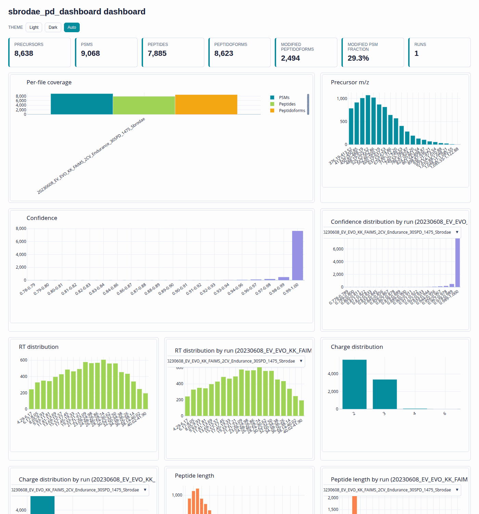
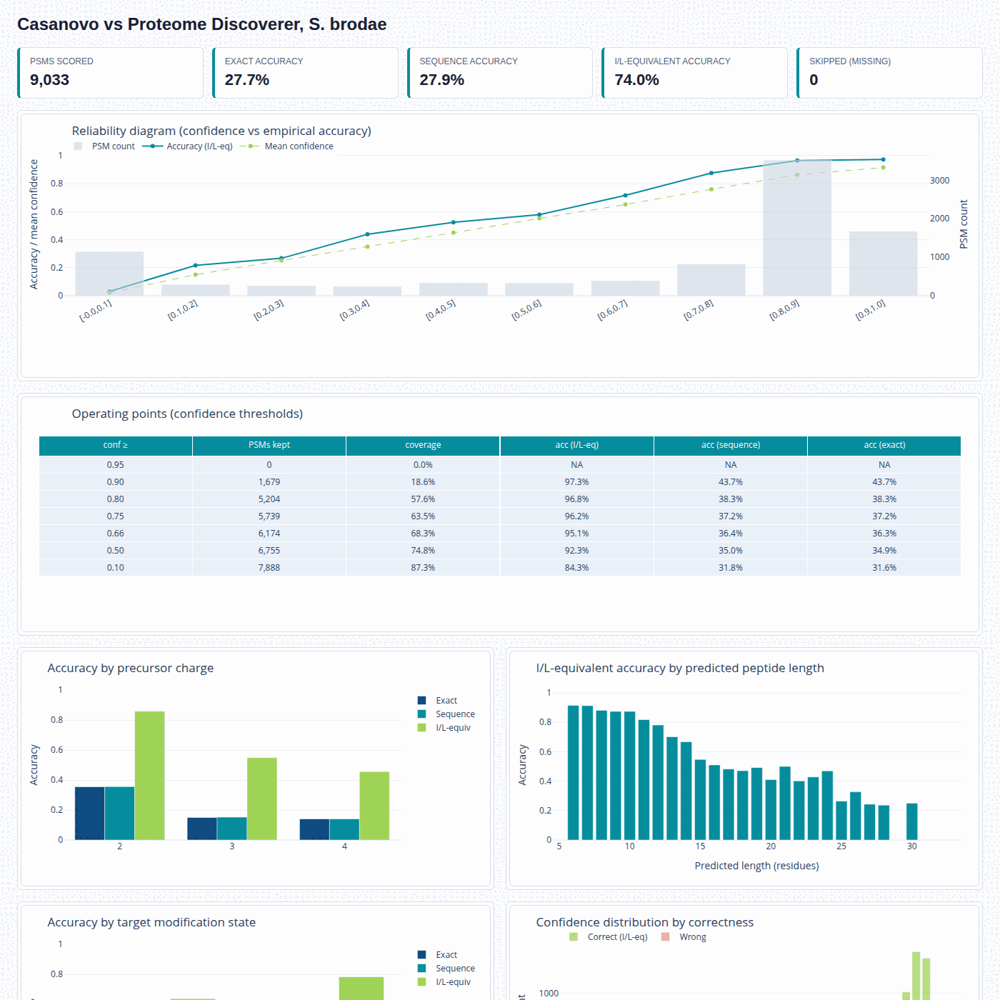
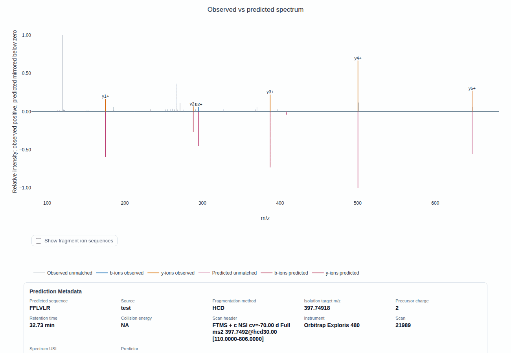
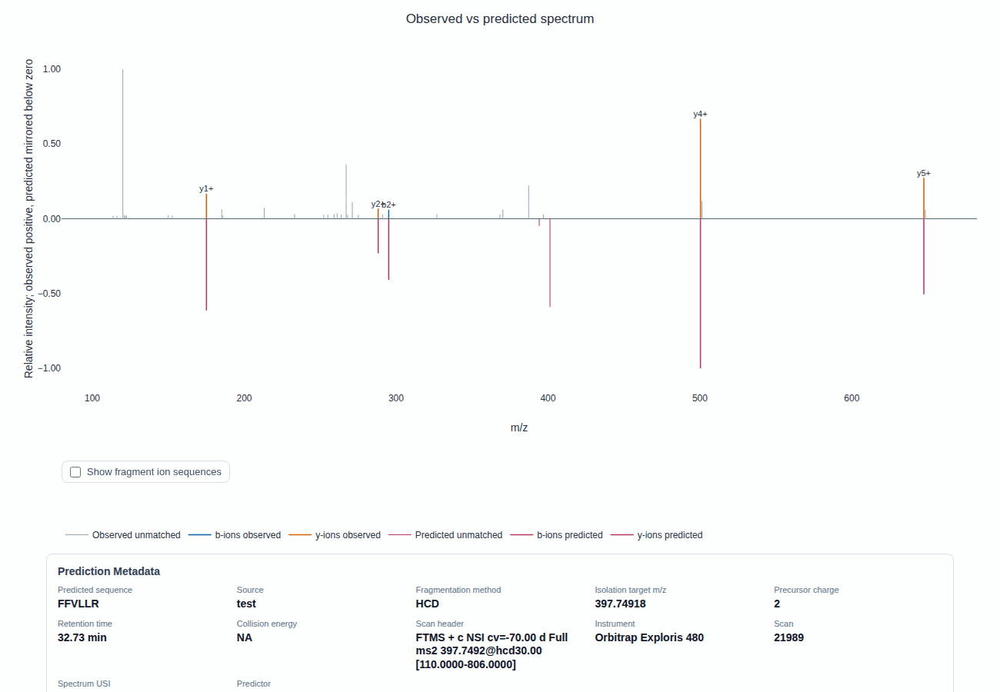
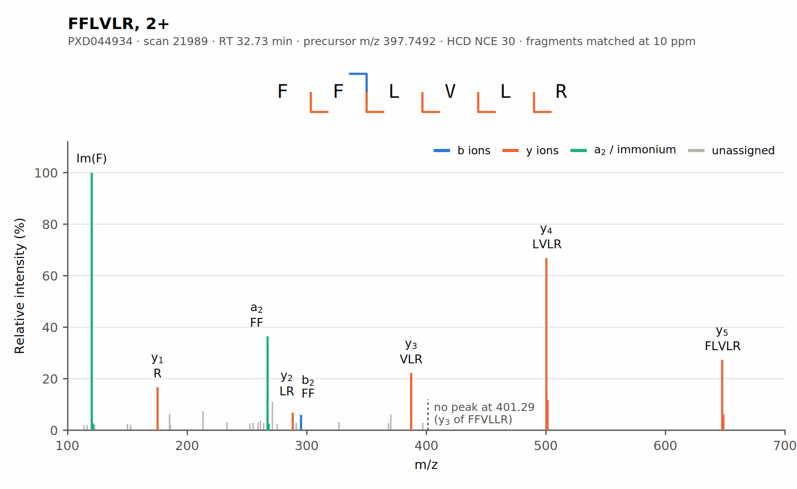

# An agent session, from download to figure

This page follows one analysis with an AI agent, from downloading public data to a publication figure. You type the questions. The agent downloads the data, calls the proteomics-mcp tools, and writes its own Python or shell commands for anything the tools don't do. The session below was recorded with Claude Code; the same prompts work in any agent that can run the tools and local commands.

| | |
|---|---|
| **Data** | The S. brodae tables of the manuscript's Zenodo supplement ([record 23295902](https://doi.org/10.5281/zenodo.23295902), a 24 MB zip), and one spectrum fetched from PRIDE |
| **Sample** | *Candidatus* Scalindua brodae, an anammox bacterium ([PXD044934](https://www.ebi.ac.uk/pride/archive/projects/PXD044934)) |
| **Session** | 9 prompts, about 15 minutes of agent time |
| **You need** | proteomics-mcp connected to an agent ([Connect a client](../clients.md)), and internet access |

## Before you start

1. Connect proteomics-mcp to your agent as described in [Connect a client](../clients.md). The agent must also be able to run commands on your computer: Claude Code, Codex CLI and Gemini CLI can.
2. Make a new, empty folder wherever you like, and start the agent there. The agent downloads and writes everything into that folder, and the paths in its answers are relative to it.
3. Type the prompts below one at a time, in the same session. The agent asks before it runs a command or a tool: approve each one, or allow the proteomics-mcp tools for the session.

Agents don't answer the same way twice. Your session will differ in wording and in details, but the numbers below are what the tools return, so yours should match.

## 1. What can you do?

```text
Check that you can use the proteomics-mcp tools. What can you do with them? Group the tools by task, briefly.
```

**Tools:** `describe_predictor_model` (model `Prosit_2020_intensity_HCD`).

The agent makes one live call, to the Koina prediction server, and groups the 53 tools by task:
- getting data in;
- predicting fragment spectra;
- scoring;
- viewing spectra;
- exploring PSM and peptide tables;
- dataset statistics and QC;
- reports and dashboards.

This is a cheap check that the server is connected. The [reference](../reference.md) lists the same tools with their inputs and outputs.

## 2. Get the data

```text
Download the supplement of the proteomics-mcp paper from Zenodo (https://zenodo.org/records/23295902, the file supplement.zip) into data/ and unpack it. I want to work with the Candidatus Scalindua brodae sample: which files belong to it, and what is in them?
```

**Commands:** `curl` and `unzip`, then a few lines of pandas to look inside the tables. To avoid installing anything globally, the agent runs pandas through `uv run --with pandas`.

The agent finds the files for the S. brodae run:

| File | What it is |
|---|---|
| `processed/sbrodae/proteome_discoverer_PSMs.xlsx` | Database search results from Proteome Discoverer (Sequest HT and Percolator), filtered to 1% FDR: 9,068 PSMs, one per scan |
| `processed/sbrodae/casanovo_predictions.csv` | Casanovo de novo predictions for the same spectra: 9,053 rows. The `targets` column holds the Proteome Discoverer peptide; there is no scan-number column |
| `figure_assets/examples/23_sbrodae_casanovo_top5/` | The manuscript's worked example: the five best-scoring Casanovo predictions |
| `raw_file_inventory.tsv` | The raw file name, `20230608_EV_EVO_KK_FAIMS_2CV_Endurance_30SPD_1475_Sbrodae.raw`, with the size and checksum of its mzML |

The spectra are not in the supplement. The later prompts fetch them from PRIDE one at a time, by their Universal Spectrum Identifier (USI), instead of downloading the 600 MB run.

## 3. Overview and dashboard

```text
Give me an overview of both S. brodae tables, the Casanovo de novo predictions and the Proteome Discoverer PSMs: how many PSMs and peptides, how confident, which modifications. Also make a dashboard of the Proteome Discoverer PSMs that I can open in my browser.
```

**Tools:**
- `inspect_psm_table` and `summarize_modifications`, once for each table (adapters `proteome_discoverer` and `casanovo`);
- `build_id_dashboard` for the Proteome Discoverer table.

| | Proteome Discoverer | Casanovo |
|---|---|---|
| PSMs | 9,068 | 9,033 with a prediction |
| Distinct peptides / peptidoforms | 7,885 / 8,623 | 8,302 / 8,787 |
| Confidence | 1 − PEP: median 0.9993 | sequence probability: median 0.84, mean 0.67, best 0.94 |
| Modified PSMs | 2,659 (29%) | 2,734 (30%) |
| Oxidation (M) | 1,930 | 1,710 |
| Carbamidomethyl (C) | 1,497 | 1,438 |
| Other | acetyl (protein N-term) 2 | deamidation (N, Q) 182, acetyl 22, carbamyl 20, ammonia loss 4 |

The Proteome Discoverer table is already filtered at 1% FDR, so it contains no low-confidence PSMs. Casanovo's confidence spreads much more widely. Deamidation, carbamyl and ammonia loss appear only in the Casanovo results, because the database search didn't look for them, so those calls can't be checked against it.

The dashboard is one HTML file, `outputs/sbrodae_pd_dashboard_dashboard.html`. It shows totals, distributions of precursor m/z, retention time, confidence, charge and peptide length, and modifications. Next to it, `build_id_dashboard` writes the data behind the plots (`…_summary.json`) and the PSM table in the package's standard columns (`…_enriched.csv`).



## 4. How accurate is it?

```text
How accurate is Casanovo here, taking the Proteome Discoverer peptide as the right answer? Which confidence cut-off would give me 95% agreement, and how many PSMs would I keep? Make the accuracy report as HTML too.
```

**Tools:**
- `summarize_prediction_accuracy` (adapter `casanovo`, `target_field` `source_columns.targets`), twice;
- `render_prediction_accuracy_html`.

Casanovo agrees with Proteome Discoverer on 74.0% of the 9,033 spectra when I and L count as the same amino acid, which they must: they have the same mass. Agreement on the exact sequence is 27.7%, because Casanovo mostly writes L where the database has I.

| Confidence cut-off | PSMs kept | Share kept | Agreement (I = L) |
|---|---|---|---|
| 0.5 | 6,755 | 75% | 92.3% |
| 0.6643 | 6,174 | 68% | 95.1% |
| 0.75 | 5,739 | 64% | 96.2% |
| 0.8 | 5,204 | 58% | 96.8% |
| 0.9 | 1,679 | 19% | 97.3% |

To find the exact cut-off for 95%, the agent wrote a short script, then ran the tool again with that value, 0.6643, among its thresholds. The tool also breaks agreement down:
- **By charge:** 86% at 2+, 55% at 3+.
- **By length:** about 91% for 6- and 7-mers, under 50% beyond 16 residues.
- **By modification:** 64% for modified peptides, 78% for unmodified.

The report is `outputs/sbrodae_casanovo_accuracy.html`. It shows agreement against confidence, the cut-off table, the breakdowns, and how confidence differs between agreeing and disagreeing calls.



## 5. Join the two tables

```text
The Casanovo table has no scan numbers. Match each Casanovo prediction to its Proteome Discoverer PSM, so it gets the scan number and retention time, and save that joined table. Then list the five most confident Casanovo predictions that disagree with Proteome Discoverer (treat I and L as equal).
```

**Commands:** a pandas script the agent writes, [`join_casanovo_pd.py`](agent_session/join_casanovo_pd.py).

No tool does this join, so the agent writes one. It matches each prediction to the PSM with the same peptidoform, charge and precursor m/z, which match exactly. It saves `outputs/sbrodae_casanovo_with_pd_scans.csv`, with the Proteome Discoverer scan number, retention time, q-value, PEP, XCorr and protein for each prediction:
- 9,023 rows match a single scan.
- 30 rows (15 pairs) can't be resolved: the same precursor was fragmented twice, so two PSMs agree on everything except the scan. The agent marks these `ambiguous` and lists both scans, rather than guess.

For 75 protein N-terminal peptides, the `targets` column still includes the initial Met that Proteome Discoverer marks as removed (`N-Term(Prot)(Met-loss)`), while Casanovo predicts the peptide without it. The agent removes that Met before comparing. 64 of the 75 then agree, and overall agreement becomes 74.4%.

The five most confident disagreements:

| Scan | RT (min) | Casanovo (confidence) | Proteome Discoverer | PD PEP | PD XCorr |
|---|---|---|---|---|---|
| 21989 | 32.73 | FFLVLR (0.936) | FFVLLR | 0.131 | 1.03 |
| 1980 | 5.71 | YVPVRR (0.932) | YVRPVR | 0.081 | 1.44 |
| 5644 | 10.73 | LNNLYK (0.932) | LNNYIK | 0.113 | 1.39 |
| 15628 | 24.22 | LSLSALR (0.928) | TVLSAIR | 0.114 | 1.65 |
| 18810 | 28.48 | SLVLWR (0.925) | ISVLWR | 0.060 | 1.50 |

All five are short 2+ peptides with the same mass as the database peptide: swapped residues, or equal-mass pairs such as LS and TV. All five are also borderline database hits. They pass 1% FDR, but each has a 6–13% probability of being wrong (PEP). Which peptide is right depends on which fragment ions are present, and that needs the spectrum.

## 6. Settle a disagreement

```text
Take the most confident of those disagreements. The raw data is public in PRIDE as PXD044934, so fetch that spectrum, score both peptides (Casanovo's and Proteome Discoverer's) against it with MS2PIP, and make a mirror plot for each. Which peptide does the spectrum support?
```

**Tools:**
- `retrieve_usi_spectrum` for `mzspec:PXD044934:20230608_EV_EVO_KK_FAIMS_2CV_Endurance_30SPD_1475_Sbrodae:scan:21989`;
- `predict_fragments` and `score_spectrum`, once for each peptide;
- `render_spectrum_comparison`, once for each peptide.

The spectrum has 34 peaks, precursor m/z 397.7492 at 2+, recorded at 32.73 min. Both peptides have the same mass (precursor error −1.57 ppm for either), so mass can't decide.

| MS2PIP (HCD) | FFLVLR (Casanovo) | FFVLLR (Proteome Discoverer) |
|---|---|---|
| Spectral angle | 0.742 | 0.655 |
| Cosine / Pearson | 0.919 / 0.877 | 0.856 / 0.804 |
| Comet XCorr / X! Tandem hyperscore | 1.198 / 19.3 | 0.949 / 16.2 |
| Predicted ions matched | 6 of 8 | 5 of 8 |
| Spectrum intensity explained | 43% | 37% |

Casanovo's peptide scores better on every measure, and one peak settles it. The two peptides differ only in the order of V and L, which changes a single fragment, y3:
- FFLVLR predicts y3 (VLR) at 387.271. The spectrum has a peak at 387.2715, a third of the height of y4, the strongest fragment.
- FFVLLR predicts y3 (LLR) at 401.287, and MS2PIP expects it to be strong. There is no peak near 401.

The other fragments are the same for both peptides. So the spectrum supports FFLVLR, which fits Proteome Discoverer's weak statistics for FFVLLR (PEP 0.13, XCorr 1.03). The call rests on one diagnostic ion in a sparse spectrum.





`render_spectrum_comparison` takes one payload: the observed spectrum, the prediction and the scores. The agent builds it from the results of `retrieve_usi_spectrum`, `predict_fragments` and `score_spectrum`.

## 7. Second opinion

```text
Check that verdict with a second predictor: score both peptides again with Prosit through Koina, using the spectrum's own collision energy if you can find it.
```

**Tools:** `score_spectrum` with `predictor_backend` `koina` and `predictor_model` `Prosit_2020_intensity_HCD`, once for each peptide.

Koina predictions use the spectrum's own normalised collision energy, here NCE 30 from the scan header (`…397.7492@hcd30.00`). The result records it as `collision_energy_source: "spectrum: scan filter @hcd30.00"`. A `collision_energy` argument overrides it.

| Spectral angle | FFLVLR | FFVLLR | Gap |
|---|---|---|---|
| Prosit 2020 HCD, NCE 30 | 0.493 | 0.477 | +0.016 |
| MS2PIP HCD | 0.742 | 0.655 | +0.087 |

Prosit ranks FFLVLR first too, by a smaller margin. It fits both peptides less well than MS2PIP. It expects y5 to be the strongest fragment, while in this spectrum y4 is about 2.5 times stronger than y5. It also gives the diagnostic y3 less weight. Both predictors expect a clear y3 for FFVLLR at 401.287, where there is no peak. The verdict stands.

## 8. Publication figure

```text
Make a publication-quality vector figure (SVG) of the better-supported peptide's spectrum, annotated, with the fragment ion sequences shown.
```

**Tools and commands:** `render_static_spectrum` for an annotated SVG, then the agent's own matplotlib script, [`plot_annotated_spectrum.py`](agent_session/plot_annotated_spectrum.py).

`render_static_spectrum` writes an annotated spectrum as SVG, PDF or PNG in one call (`view` `annotated`, `include_fragment_sequences`). For this figure the agent wanted more: a sequence ladder over the peptide and a mark where FFVLLR's y3 would be. So it wrote its own script, rendered the figure, looked at it, and adjusted the layout until no labels overlapped.

The figure, `outputs/sbrodae_scan21989_FFLVLR_figure.svg` with a matching PDF, colours peaks by ion type:
- b ions in blue;
- y ions in orange;
- a2 and the phenylalanine immonium ion, the largest peak, in green;
- unassigned peaks in grey.

The text stays editable in Illustrator or Inkscape.



## 9. Write it up

```text
Write a short report of what we found, as report.md in this folder: the dataset, the key numbers, the figures and files you made (with paths), and the caveats I should keep in mind.
```

**Commands:** the agent lists the files it made and writes `report.md`.

The report covers:
- **Dataset:** the supplement and the run.
- **Key numbers:** the two tables side by side, agreement and the 0.664 cut-off, and the scan 21989 verdict with both predictors.
- **Files:** every output and script with its path.
- **Caveats:**
  - Proteome Discoverer is not ground truth: the confident disagreements are borderline database hits.
  - The FFLVLR call rests on one ion in a sparse spectrum.
  - 30 Casanovo rows have no definite scan.
  - Casanovo's extra modifications can't be checked against the search.

## What you have at the end

| Path | What it is |
|---|---|
| `data/supplement/` | The unpacked Zenodo supplement |
| `outputs/sbrodae_pd_dashboard_dashboard.html` | Dashboard of the Proteome Discoverer PSMs, with its `_summary.json` and `_enriched.csv` |
| `outputs/sbrodae_casanovo_accuracy.html` | Casanovo accuracy report |
| `outputs/sbrodae_casanovo_with_pd_scans.csv` | Casanovo predictions joined to Proteome Discoverer scans |
| `outputs/sbrodae_scan21989_*_mirror.html` | Mirror plots of scan 21989 for both peptides |
| `outputs/sbrodae_scan21989_FFLVLR_figure.svg`, `.pdf` | The publication figure |
| `scripts/` | The agent's join and figure scripts |
| `report.md` | The written summary |

The HTML pages load Plotly from a CDN, so they need an internet connection to display.

For more on writing prompts, see the [prompt examples](../prompt_examples/00_overview.md).
